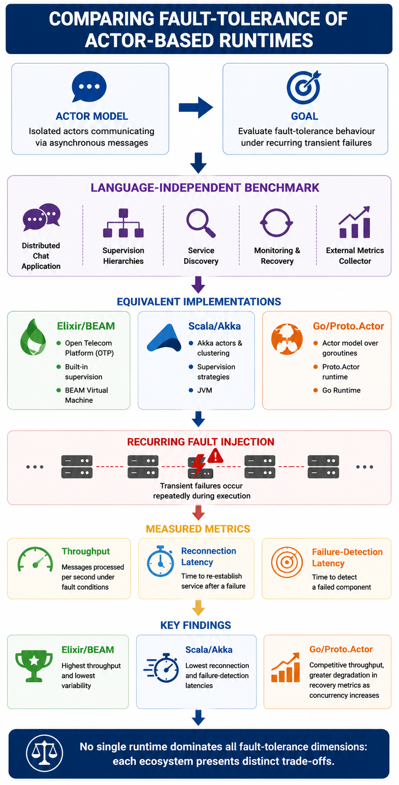
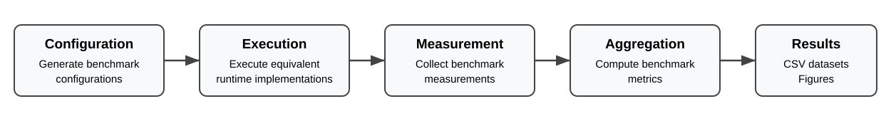

# Benchmarking Fault-Tolerance Characteristics of Actor-Based Runtimes

[](https://doi.org/10.3390/computers15070439)
[](LICENSE)

This repository contains the complete benchmark framework, source code, automation scripts, experimental artefacts, and replication package accompanying the published paper:

> **Luís Nogueira** and **Jorge Coelho**  
> **Benchmarking Fault-Tolerance Characteristics of Actor-Based Runtimes**  
> *Computers*, **2026**, **15**(7), 439.  
> https://doi.org/10.3390/computers15070439

📄 **Open-access paper**

https://www.mdpi.com/2073-431X/15/7/439

<p align="center">
  
  <br>
  <em>Graphical abstract of the benchmarking framework.</em>
</p>

The project provides a language-independent benchmarking framework for evaluating the fault-tolerance characteristics of actor-based distributed systems under recurring transient failures.

Three functionally equivalent benchmark implementations are provided:

* **Elixir / BEAM**
* **Scala / Akka**
* **Go / Proto.Actor**

All implementations execute the same distributed chat application, use identical benchmark configurations, and rely on a common external statistical component for data collection. This architecture minimises implementation-specific bias while enabling fair, reproducible, and language-independent comparisons across actor runtimes.

The repository constitutes the complete replication package accompanying the published study, including the benchmark implementations, experimental configurations, automation scripts, statistical analysis tools, datasets, and figure-generation scripts required to reproduce the published results.

---

# Repository Structure

```text
benchmark/
│
├── assets/                  Documentation figures
├── scripts/                 Automation scripts
├── stats/                   Configuration generator, statistics and analysis
│   ├── generated_configs/   Generated benchmark configurations
│   └── results/             Aggregated benchmark results
│
├── elixir/                  Elixir / BEAM implementation
├── scala-akka/              Scala / Akka implementation
└── go-protoactor/           Go / Proto.Actor implementation
```

---

# Benchmark Workflow

<p align="center">
  
</p>

The benchmark workflow consists of five stages:

1. Benchmark configurations are generated automatically as YAML files.
2. Each generated configuration is executed by the selected runtime implementation.
3. The external statistical component collects benchmark measurements.
4. The collected measurements are aggregated into CSV datasets.
5. The resulting datasets are processed to reproduce the analyses and figures reported in the accompanying paper.

---

# Benchmark Metrics

The benchmark evaluates three complementary dimensions of supervised fault recovery:

* **Throughput under recurring transient failures**
* **Client reconnection latency**
* **Failure-detection latency**

Faults are injected automatically according to configurable benchmark parameters, enabling reproducible comparisons across all runtime implementations under equivalent experimental conditions.

---

# Tested Environment

The benchmark was developed and validated using the following software versions.

| Component | Version |
|-----------|---------|
| Elixir | 1.18.3 |
| Erlang/OTP | 27 |
| Scala | 3.3.5 |
| Akka | 2.10.2 |
| Go | 1.23.4 |
| Proto.Actor | 0.4.0 |
| Python | 3.12 |
| RabbitMQ | 4.x |

---

# Reproducing the Experiments

## Prerequisites

* A local **RabbitMQ** instance.
* **Python 3**.
* **Elixir/Erlang**.
* **Scala**, **sbt**, and a compatible **JDK**.
* **Go**.

For Scala, copy `scala-akka/.env.example` to `scala-akka/.env` and configure your own `AKKA_KEY` (Akka licence key). The licence key is intentionally not included in this repository.

By default, the RabbitMQ broker and the Akka cluster host use `localhost` (`127.0.0.1`). For distributed deployments, configure the corresponding environment variables before running the benchmark.

## Steps

Create the Python virtual environment used by the statistical tools:

```bash
cd stats

python3 -m venv venv
source venv/bin/activate
pip install -r requirements.txt
```

Generate the benchmark configurations:

```bash
python3 generate_configs.py
```

Execute the complete benchmark campaign:

```bash
cd ../scripts

./clean.sh
./all_tests.sh
```

The `all_tests.sh` script executes the benchmark campaign sequentially for the three runtime implementations. Each implementation is built automatically when required.

After all benchmark campaigns have completed, aggregate the experimental data and generate the publication figures:

```bash
cd ../stats

python3 aggregator.py
python3 plotting.py
```

The aggregated CSV datasets are written to `stats/results/`.

Generated publication figures are stored under `stats/results/figures/`.

Each runtime implementation may also be executed independently using its own `run_benchmark.sh` or `run_experiment.sh` scripts.

> **Note:** `clean.sh` removes all generated benchmark results, including the contents of `stats/results/` and each implementation's `scripts/results/` directory. If you wish to preserve previously generated datasets, make a copy before executing the script.

---

# Repository Contents

The repository includes:

* three equivalent benchmark implementations;
* benchmark configuration generators;
* automation scripts for benchmark execution;
* statistical processing and aggregation tools;
* aggregated experimental datasets;
* scripts for reproducing the published analyses and figures;
* graphical assets accompanying the publication.

---

# Research Contribution

Unlike traditional actor-system benchmarks, which primarily evaluate throughput or message latency, this benchmark investigates the behaviour of actor-based runtimes under recurring transient failures using equivalent distributed implementations and a common experimental methodology.

The principal contributions of this work are:

* a language-independent benchmarking methodology for actor-based runtimes;
* equivalent implementations for Elixir/BEAM, Scala/Akka, and Go/Proto.Actor;
* reproducible fault-injection scenarios based on supervised crash recovery;
* an external statistical component that minimises measurement interference;
* a reproducible experimental framework for evaluating throughput, reconnection latency, and failure-detection latency under equivalent workloads.

---

# Citation

If you use this benchmark or any part of its implementation in your research, please cite:

```bibtex
@article{Nogueira2026Benchmark,
  author  = {Luís Nogueira and Jorge Coelho},
  title   = {Benchmarking Fault-Tolerance Characteristics of Actor-Based Runtimes},
  journal = {Computers},
  year    = {2026},
  volume  = {15},
  number  = {7},
  pages   = {439},
  doi     = {10.3390/computers15070439}
}
```

---

# License

This project is distributed under the MIT License.

If this repository contributes to your research, please cite the accompanying publication.